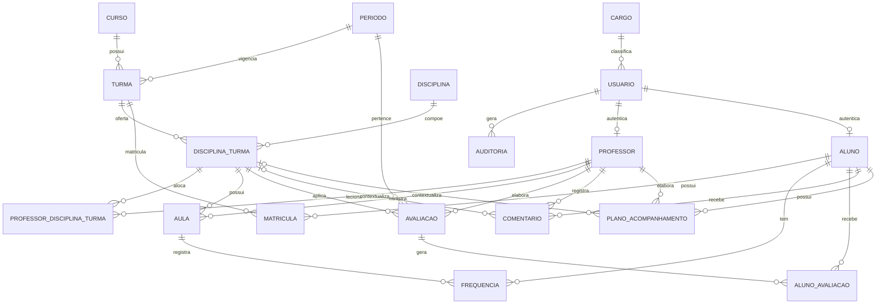

# EDULYTICS — Monitoramento do Desempenho Acadêmico de Estudantes

> Plataforma web voltada ao acompanhamento pedagógico integral de estudantes, reunindo frequência, avaliações, observações comportamentais, planos de acompanhamento e indicadores para apoio à decisão docente, com painel dedicado para consulta estudantil.

[](https://plataforma.gpinovacao.senai.br/plataforma/demandas-da-industria/interna/12430)

---

## 1. Problema Atendido e Público-Alvo

Muitas plataformas educacionais restringem o acompanhamento acadêmico ao registro isolado de notas e faltas. Essa visão limitada dificulta a identificação precoce de dificuldades de aprendizagem, queda gradual de engajamento ou fatores comportamentais e sociais que impactam o desempenho do estudante.

- **Público-alvo principal**: **Docentes** (registro de aulas, chamadas com checklist pedagógico, avaliações/notas, observações qualitativas, planos de acompanhamento e leitura de indicadores).
- **Público-alvo secundário**: **Alunos** (consulta segura e isolada à própria frequência, notas e observações autorizadas para visualização estudantil).

---

## 2. Integrantes e Orientação

- **Instituição**: SENAI Gaspar Ricardo Júnior — Sorocaba (SP), 2026
- **Curso**: Tecnólogo em Análise e Desenvolvimento de Sistemas
- **Integrantes**:
  - Cauã Felipe Carvalho
  - Guilherme Castro de Oliveira
  - Guilherme Stecker de Almeida
  - Johann Arruda Andrade
  - Kevin Paião Reisauskas
- **Orientador (Frameworks Front-End)**: Prof. Deivison Takatu

---

## 3. Tecnologias Utilizadas e Justificativas

| Camada | Tecnologias | Justificativa |
|---|---|---|
| **Frontend** | React 19, Vite 8, Tailwind CSS 4, React Router DOM | Componentização reaproveitável, build rápido, estilização consistente e roteamento SPA com proteção por perfil. |
| **Integração REST** | `fetch` nativo (`apiClient`), JWT Bearer, RFC 7807 (`ProblemDetail`) | Comunicação desacoplada com `/api/v1` sem dependências pesadas, tratamento padronizado de erros e suporte a `AbortController`. |
| **Backend** | Java 17, Spring Boot, Spring Data JPA, Spring Security | API RESTful em camadas (*package-by-feature*), validação robusta e documentação OpenAPI/Swagger. |
| **Banco de Dados** | PostgreSQL 17.11 (Amazon RDS) | Integridade referencial, constraints de domínio e suporte a `JSONB` para trilha de auditoria LGPD e checklists. |
| **Testes** | `node:test` (`npm test`), ESLint, Vite Build | Validação automatizada de cálculos acadêmicos, transporte HTTP, contratos `/api/v1`, regras RBAC e LGPD. |

---

## 4. Funcionalidades Principais (v1)

- **Autenticação JWT e Controle por Perfil (`/login`)**: login integrado a `/api/v1/auth/login`, restauração de sessão em `/api/v1/auth/me` e redirecionamento automático para `Professor` ou `Aluno` (sem perfil Coordenação na v1, conforme issue `#67`).
- **Catálogo e Contexto Acadêmico Global (`/professor/cursos`, `/professor/visao-geral`)**: busca, filtro, ordenação e paginação de cursos, além de seleção persistente de `Curso → Turma → Disciplina` compartilhada entre todas as telas docentes.
- **Aulas e Controle de Frequência (`/professor/frequencia`)**: criação/finalização/cancelamento de aulas e chamada em lote com os 4 status (`PRESENTE`, `AUSENTE`, `FALTA_JUSTIFICADA`, `ATRASO`), justificativa, checklist de aula e observação.
- **Avaliações e Lançamento de Notas (`/professor/avaliacoes`)**: criação e correção de avaliações e lançamento de notas por aluno com validação de intervalo (`0 <= nota <= valorTotal`).
- **Aprendizagem e Planos de Acompanhamento (`/professor/aprendizagem`)**: comentários pedagógicos tipificados (`COMPORTAMENTO`, `DESEMPENHO`, `SAUDE`, `SOCIAL`) com flag LGPD `visivelAluno` (`false` por padrão) e gestão de planos individuais.
- **Indicadores e Relatórios (`/professor/desempenho`, `/professor/relatorios`)**: cálculo de taxa de frequência (corte oficial de **75%**, contando `ATRASO` como presença e `FALTA_JUSTIFICADA` como ausência), média ponderada (0–10), alertas de risco, exportação CSV (`;` + BOM UTF-8) e impressão PDF.
- **Área do Aluno (`/aluno`)**: painel individual com taxa de frequência, média ponderada, notas, chamadas e somente observações pedagógicas autorizadas (`visivelAluno = true`).

---

## 5. Arquitetura e Modelo de Dados

### 5.1 Fluxo da Solução

```text
Frontend React/Vite (BrowserRouter + AuthContext + AcademicContext + apiClient)
        │  HTTPS / JSON (Authorization: Bearer <JWT> · RFC 7807 ProblemDetail)
        ▼
Backend Spring Boot (/api/v1/*) [ou adaptador Mock /api/v1 em desenvolvimento offline]
        │  JPA / Flyway
        ▼
PostgreSQL 17.11 (Amazon RDS — monitoramento_academico)
```

### 5.2 Diagrama de Entidade-Relacionamento (v1 — atualizado sem `COORDENADOR`, issue `#67`)



---

## 6. Instalação, Configuração e Execução Local

### Pré-requisitos
- Node.js 20+ e npm
- (Opcional, para integração com API real) Java 17+ e backend Spring Boot em execução

### Passo a Passo

1. **Instale as dependências**:
   ```bash
   npm install
   ```

2. **Configure o ambiente** (opcional — sem `.env`, o frontend inicia automaticamente no modo `Mock /api/v1` compatível com o seed do PostgreSQL):
   ```bash
   cp .env.example .env
   ```
   Ajuste `VITE_API_URL` (ex.: `https://api.seu-dominio.com` ou `http://localhost:8080`) e `VITE_API_MODE=http`.

   > **Credenciais de demonstração no modo Mock `/api/v1`** (espelhando o seed de `monitoramento_academico.sql`):
   > - **Professor**: `ana@exemplo.com` / `123456` (ou `bruno@exemplo.com` / `123456`)
   > - **Aluno**: `carla@exemplo.com` / `123456` (ou `diego@exemplo.com`, `elisa@exemplo.com`, `felipe@exemplo.com` / `123456`)

3. **Execute o servidor de desenvolvimento**:
   ```bash
   npm run dev
   ```

4. **Execute o servidor HTTP local de contrato (opcional, para testar modo `http` sem JVM)**:
   ```bash
   npm run api:mock
   ```

5. **Execute testes unitários, integração HTTP real, quality gates DevOps, lint e build**:
   ```bash
   npm test
   npm run test:devops
   npm run lint
   npm run build
   ```

6. **Ou execute toda a stack via Docker Compose (PostgreSQL + Backend + Frontend Nginx)**:
   ```bash
   docker compose up --build
   ```

---

## 7. Documentação Complementar e Entregáveis

- **Relatório Acadêmico (Mini TCC ABNT)**: [`docs/MiniTCC_frontend2026.pdf`](./docs/MiniTCC_frontend2026.pdf)
- **Documentação Técnica do Frontend e Integrações**: [`DOCUMENTACAO_TECNICA.md`](./DOCUMENTACAO_TECNICA.md)
- **Integração HTTP, Testes e Esteira DevOps/CI**: [`docs/DEVOPS_INTEGRACAO.md`](./docs/DEVOPS_INTEGRACAO.md)
- **Planejamento Arquitetural Completo (Banco, Backend, Frontend)**: [`docs/plano/`](./docs/plano/00-visao-geral.md)
- **Deploy Estático em Nuvem (Amazon S3)**: [`docs/frontend-s3.md`](./docs/frontend-s3.md)

---

## 8. Status da Entrega v1 e Próximas Etapas

- **Frontend, Backend Spring Boot (`/api/v1`) e Integração**: todos os módulos acadêmicos da v1 (autenticação JWT stateless, catálogo e gestão de matrículas, aulas e frequência com 4 status/checklist, avaliações e notas, comentários com privacidade LGPD `visivelAluno`, planos de acompanhamento, indicadores com corte de **75%**, relatórios CSV/PDF, Painel do Aluno e observabilidade via SLF4J + `/actuator/metrics` + `/api/v1/auditoria`) estão implementados, containerizados e validados pelas 3 esteiras CI/CD no GitHub Actions.
- **Próximas etapas planejadas**:
  1. Módulo de **Ciência de Dados** (issues `#48`, `#49`, `#50` — ETL, tratamento estatístico e séries avançadas).
  2. Provisionamento manual na **AWS** (S3/CloudFront HTTPS + EC2 + Amazon RDS PostgreSQL 17 com migrações Flyway).
  3. Envio de e-mail SMTP/SES para recuperação de senha institucional.
