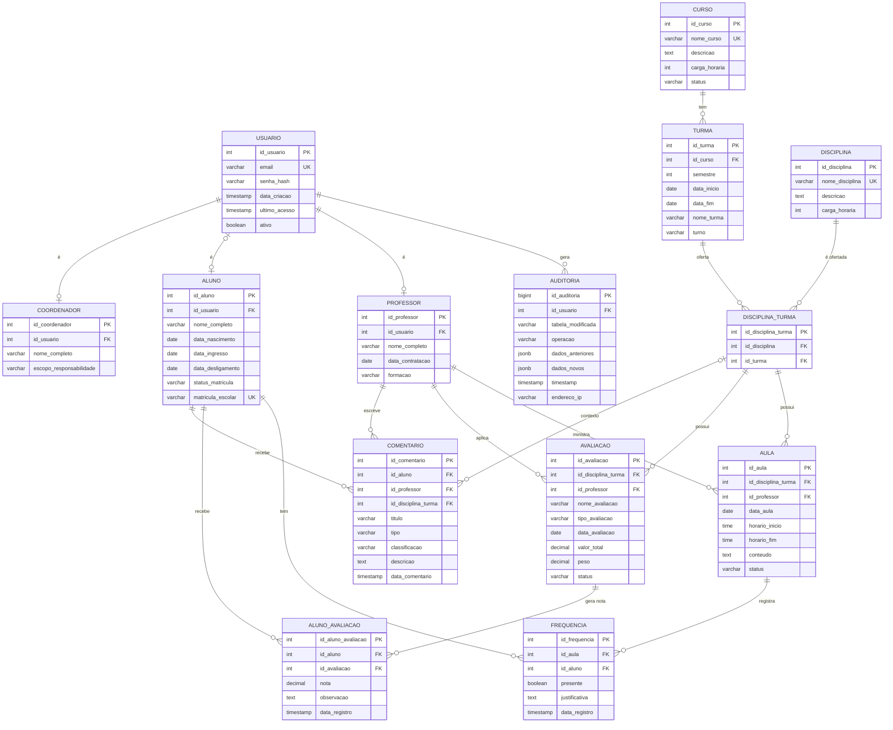
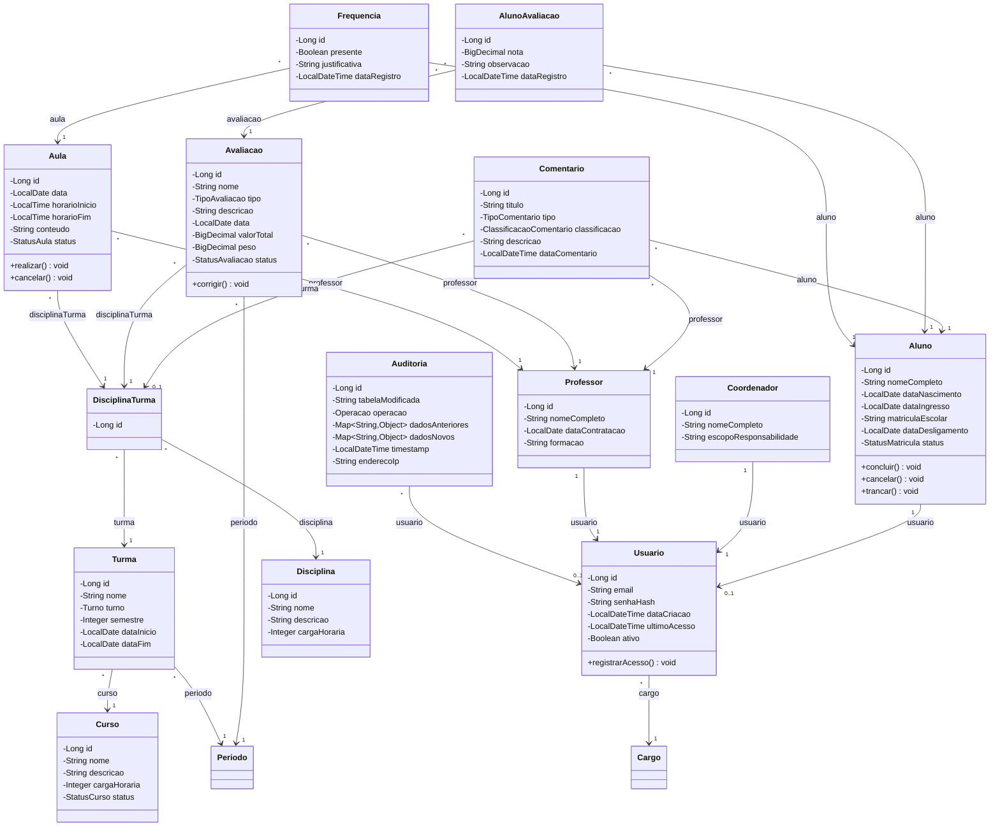

# [Desafios relacionados ao Monitoramento do Desempenho Acadêmico de Estudantes](https://plataforma.gpinovacao.senai.br/plataforma/demandas-da-industria/interna/12430)

## Proposta
Muitas plataformas educacionais empregadas em escolas se limitam a registar dados referentes a notas e frequência de alunos. Este projeto é uma plataforma que propõe incluir outras informações valiosas como comportamento e evolução do desempenho para tomada de decisões pedagógicas personalizadas e aprimorar a eficiência dos professores otimizando um trabalho anteriormente manual.
Essa plataforma tem como público-alvo principalmente os docentes, embora possa ser utilizado adicionalmente por alunos para que possam acessar suas próprias informações.

## Arquitetura

### Diagrama de Entidade-Relacionamento

### Diagrama de Classes

```mermaid
classDiagram
  direction TB
  class Operacao { <> INSERT UPDATE DELETE }
  class StatusCurso { <> ATIVO INATIVO SUSPENSO }
  class Turno { <> MANHA TARDE NOITE }
  class StatusAula { <> PLANEJADA REALIZADA CANCELADA }
  class TipoAvaliacao { <> PROVA TRABALHO SEMINARIO CONTINUA }
  class StatusAvaliacao { <> PLANEJADA REALIZADA CORRIGIDA }
  class TipoComentario { <> COMPORTAMENTO DESEMPENHO SAUDE SOCIAL }
  class ClassificacaoComentario { <> POSITIVO NEUTRO NEGATIVO }
  class StatusMatricula { <> ATIVA CONCLUIDA CANCELADA TRANCADA }
```

Usuario.registrarAcesso() atualiza ultimoAcesso.
Aluno.concluir(), cancelar() e trancar() controlam as transições de status e a dataDesligamento.
Aula.realizar() e cancelar() mudam o status da aula.
Avaliacao.corrigir() muda o status para CORRIGIDA.
Periodo.estaVigente() compara a data atual com dataInicio e dataFim.

### Critérios de Aceite
- A plataforma permite selecionar turma e uma disciplina e exibe pelo menos dois indicadores calculados a partir dos dados coletados.
- A plataforma consegue registrar dados que são guardado em um banco de dados usando integração por APIs
- A plataforma deve estar posta em um serviço de nuvem para acesso remoto
- Cada alteração de código enviada é testada automaticamente
- O projeto está versionado promovendo a organização do projeto e sua rastreabilidade.

## Solução Proposta
*Link do site implementado*

*Imagens/Prints da plataforma mostrando os dados e funcionamento