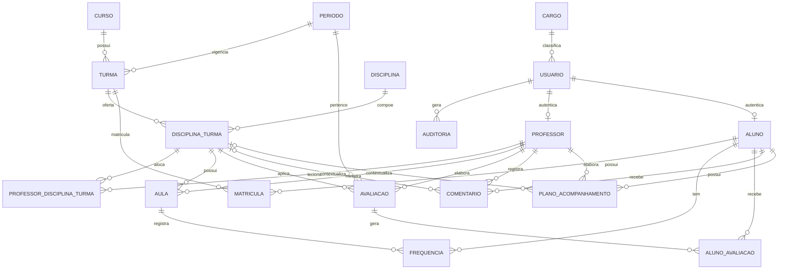

# 01 — Modelo de Dados (PostgreSQL 17.11)

> Este documento define o modelo relacional oficial do **EDULYTICS**, reconciliando o banco físico implantado no Amazon RDS (`origin/infra/database-aws:monitoramento_academico.sql`), o Diagrama de Classes (`#31`), o Dicionário de Dados (`#38`), a matriz de testes (`#55`) e as necessidades das telas (`src/components/`).
> Decisões pendentes de validação pelo dono do produto estão em [04-perguntas-abertas.md](./04-perguntas-abertas.md).

---

## 1. Fonte de Verdade e Reconciliação

| Origem no Repositório | Estado Atual | Decisão para o Plano |
|---|---|---|
| `origin/infra/database-aws:monitoramento_academico.sql` | 16 tabelas no PostgreSQL 17.11 (com `cargo`, `periodo`, `matricula` e sem `coordenador`). | **`[CONFIRMADO]`** — Adotado como baseline oficial (V1) por já estar implantado no RDS e corrigir lacunas apontadas em `DOCUMENTACAO_BACKEND.md` e `#67`. |
| `README.md` (DER e Diagrama de Classes / `#28`, `#31`) | Inclui `COORDENADOR`, omite `CARGO`, `PERIODO` e `MATRICULA` no DER, usa enums `UPPERCASE` e `auditoria.timestamp`. | **`[CONFIRMADO]`** — Remover `COORDENADOR` (`#67`), incorporar `cargo`, `periodo` e `matricula` ao DER oficial e padronizar enums/colunas via migração V2 `[PROPOSTA]`. |
| `src/components/frequencia.jsx` e `aprendizagem.jsx` | Coletam `status` com 4 valores (`Atraso`), `checklistAula`, `checklistAprendizagem` e `Plano de acompanhamento`. | **`[CONFIRMADO]`** — Estender o banco via migração Flyway V3 (`status_presenca`, `checklist_aula`, `observacao`, `checklist_itens`, `acao_acompanhamento`, `visivel_aluno` e `plano_acompanhamento`). |
| `backend_spring/.../alunos/Aluno.java` | `record` JPA sem `id_usuario` nem `data_desligamento` e nome de campo `matricula`. | Refatorar para classe JPA mapeada exatamente para a tabela `public.aluno`. |

---

## 2. Catálogo de Entidades

| # | Tabela | Origem | Propósito |
|---|---|---|---|
| 1 | `cargo` | SQL AWS | Perfis de acesso do sistema (`Professor`, `Aluno`) e nível hierárquico. |
| 2 | `usuario` | SQL AWS | Credenciais de autenticação, estado de ativação e rastreio de último acesso. |
| 3 | `professor` | SQL AWS | Dados profissionais do docente vinculados a um `usuario`. |
| 4 | `aluno` | SQL AWS | Dados cadastrais e matrícula escolar única do estudante. |
| 5 | `auditoria` | SQL AWS | Trilha de auditoria LGPD de alterações com estado anterior/novo (`JSONB`) e IP. |
| 6 | `curso` | SQL AWS | Cursos ofertados pela instituição, carga horária e status. |
| 7 | `periodo` | SQL AWS | Períodos letivos (`nome_periodo`, `ano_letivo`, janela de vigência). |
| 8 | `turma` | SQL AWS | Agrupamento de alunos de um `curso` em um `periodo` e `turno`. |
| 9 | `disciplina` | SQL AWS | Componentes curriculares reutilizáveis entre cursos/turmas. |
| 10 | `disciplina_turma` | SQL AWS | Oferta concreta de uma `disciplina` em uma `turma`. |
| 11 | `matricula` | SQL AWS | Vínculo N:N de `aluno` em `turma`, com ciclo de vida (`ativa`, `concluida`, `cancelada`, `trancada`). |
| 12 | `aula` | SQL AWS | Registro de aula planejada, ministrada ou cancelada em uma `disciplina_turma`. |
| 13 | `frequencia` | SQL AWS | Registro de comparecimento do `aluno` em uma `aula`. |
| 14 | `avaliacao` | SQL AWS | Instrumento avaliativo aplicado em uma `disciplina_turma` e `periodo`. |
| 15 | `aluno_avaliacao` | SQL AWS | Nota e observação obtidas por um `aluno` em uma `avaliacao`. |
| 16 | `comentario` | SQL AWS | Observações pedagógicas de comportamento, desempenho, saúde ou social. |
| 17 | `professor_disciplina_turma` | **`[PROPOSTA]`** | Alocação explícita de docentes às ofertas `disciplina_turma` para controle de acesso e filtros. |
| 18 | `plano_acompanhamento` | **`[CONFIRMADO — Flyway V3]`** | Planos individuais de intervenção pedagógica com objetivo, prazo, situação e resultado (originados de `aprendizagem.jsx`). |

---

## 3. Especificação Detalhada das Entidades

> Convenção de chaves primárias no SQL AWS: todas as tabelas usam `INTEGER GENERATED BY DEFAULT AS IDENTITY` (`BIGINT` em `auditoria`).
> Campos marcados com `[PROPOSTA]` não existem no `monitoramento_academico.sql` atual e serão adicionados via Flyway (Seção 9).

### 3.1 `cargo`
| Coluna | Tipo PostgreSQL | Nulidade | Default | Chave / Restrição | Origem / Nota |
|---|---|---|---|---|---|
| `id_cargo` | `INTEGER` | `NOT NULL` | `IDENTITY` | `PK` | SQL AWS |
| `nome_cargo` | `VARCHAR(60)` | `NOT NULL` | — | `UK` | SQL AWS (`'Professor'`, `'Aluno'`) |
| `descricao` | `TEXT` | `NULL` | — | — | SQL AWS |
| `nivel_acesso` | `INTEGER` | `NOT NULL` | — | `CHECK (nivel_acesso >= 0)` | SQL AWS |

### 3.2 `usuario`
| Coluna | Tipo PostgreSQL | Nulidade | Default | Chave / Restrição | Origem / Nota |
|---|---|---|---|---|---|
| `id_usuario` | `INTEGER` | `NOT NULL` | `IDENTITY` | `PK` | SQL AWS |
| `email` | `VARCHAR(255)` | `NOT NULL` | — | `UK` | SQL AWS |
| `senha_hash` | `VARCHAR(255)` | `NOT NULL` | — | — | SQL AWS (armazenar BCrypt) |
| `id_cargo` | `INTEGER` | `NOT NULL` | — | `FK -> cargo(id_cargo)` | SQL AWS |
| `data_criacao` | `TIMESTAMP` (`TIMESTAMPTZ` `[PROPOSTA]`) | `NOT NULL` | `CURRENT_TIMESTAMP` | — | SQL AWS |
| `ultimo_acesso` | `TIMESTAMP` (`TIMESTAMPTZ` `[PROPOSTA]`) | `NULL` | — | — | SQL AWS |
| `ativo` | `BOOLEAN` | `NOT NULL` | `true` | — | SQL AWS |
| `atualizado_em` | `TIMESTAMPTZ` | `NULL` | — | — | `[PROPOSTA]` |

### 3.3 `professor`
| Coluna | Tipo PostgreSQL | Nulidade | Default | Chave / Restrição | Origem / Nota |
|---|---|---|---|---|---|
| `id_professor` | `INTEGER` | `NOT NULL` | `IDENTITY` | `PK` | SQL AWS |
| `id_usuario` | `INTEGER` | `NOT NULL` | — | `FK -> usuario(id_usuario)`, `UK` | SQL AWS (1:1) |
| `nome_completo` | `VARCHAR(160)` | `NOT NULL` | — | — | SQL AWS |
| `data_contratacao` | `DATE` | `NULL` | — | — | SQL AWS |
| `formacao` | `VARCHAR(160)` | `NULL` | — | — | SQL AWS |

### 3.4 `aluno`
| Coluna | Tipo PostgreSQL | Nulidade | Default | Chave / Restrição | Origem / Nota |
|---|---|---|---|---|---|
| `id_aluno` | `INTEGER` | `NOT NULL` | `IDENTITY` | `PK` | SQL AWS |
| `id_usuario` | `INTEGER` (ver `[PROPOSTA]`) | `NOT NULL` (`NULL` `[PROPOSTA]`?) | — | `FK -> usuario(id_usuario)`, `UK` | SQL AWS exige `NOT NULL`; issue `#55` (`REL-013`) testa `NULL` (ver Pergunta 6 em [04-perguntas-abertas.md](./04-perguntas-abertas.md)) |
| `nome_completo` | `VARCHAR(160)` | `NOT NULL` | — | — | SQL AWS |
| `data_nascimento` | `DATE` | `NULL` | — | — | SQL AWS |
| `data_ingresso` | `DATE` | `NOT NULL` | — | — | SQL AWS |
| `matricula_escolar` | `VARCHAR(40)` | `NOT NULL` | — | `UK` | SQL AWS |

### 3.5 `auditoria`
| Coluna | Tipo PostgreSQL | Nulidade | Default | Chave / Restrição | Origem / Nota |
|---|---|---|---|---|---|
| `id_auditoria` | `BIGINT` | `NOT NULL` | `IDENTITY` | `PK` | SQL AWS |
| `id_usuario` | `INTEGER` | `NULL` | — | `FK -> usuario(id_usuario) ON DELETE SET NULL` | SQL AWS |
| `tabela_modificada` | `VARCHAR(100)` | `NOT NULL` | — | — | SQL AWS |
| `operacao` | `VARCHAR(30)` | `NOT NULL` | — | `CHECK (operacao IN ('INSERT','UPDATE','DELETE','LOGIN'))` `[PROPOSTA]` | SQL AWS sem CHECK |
| `dados_anteriores` | `JSONB` | `NULL` | — | — | SQL AWS |
| `dados_novos` | `JSONB` | `NULL` | — | — | SQL AWS |
| `data_hora` | `TIMESTAMP` (`TIMESTAMPTZ` `[PROPOSTA]`) | `NOT NULL` | `CURRENT_TIMESTAMP` | — | SQL AWS (substitui `timestamp` do DER) |
| `endereco_ip` | `VARCHAR(45)` | `NULL` | — | — | SQL AWS (suporta IPv4/IPv6) |

### 3.6 `curso`
| Coluna | Tipo PostgreSQL | Nulidade | Default | Chave / Restrição | Origem / Nota |
|---|---|---|---|---|---|
| `id_curso` | `INTEGER` | `NOT NULL` | `IDENTITY` | `PK` | SQL AWS |
| `nome_curso` | `VARCHAR(120)` | `NOT NULL` | — | `UK` | SQL AWS |
| `descricao` | `TEXT` | `NULL` | — | — | SQL AWS |
| `carga_horaria` | `INTEGER` | `NOT NULL` | — | `CHECK (carga_horaria > 0)` | SQL AWS |
| `status` | `VARCHAR(20)` | `NOT NULL` | `'ATIVO'` (`'ativo'` no SQL) | `CHECK (status IN ('ATIVO','INATIVO','SUSPENSO','EM_BREVE','CONCLUIDO'))` `[PROPOSTA]` | Ver Pergunta 7 em [04-perguntas-abertas.md](./04-perguntas-abertas.md) |

### 3.7 `periodo`
| Coluna | Tipo PostgreSQL | Nulidade | Default | Chave / Restrição | Origem / Nota |
|---|---|---|---|---|---|
| `id_periodo` | `INTEGER` | `NOT NULL` | `IDENTITY` | `PK` | SQL AWS |
| `nome_periodo` | `VARCHAR(80)` | `NOT NULL` | — | `UK (nome_periodo, ano_letivo)` | SQL AWS |
| `ano_letivo` | `INTEGER` | `NOT NULL` | — | `CHECK (ano_letivo >= 2000)` | SQL AWS |
| `data_inicio` | `DATE` | `NOT NULL` | — | — | SQL AWS |
| `data_fim` | `DATE` | `NOT NULL` | — | `CHECK (data_fim >= data_inicio)` | SQL AWS |

### 3.8 `turma`
| Coluna | Tipo PostgreSQL | Nulidade | Default | Chave / Restrição | Origem / Nota |
|---|---|---|---|---|---|
| `id_turma` | `INTEGER` | `NOT NULL` | `IDENTITY` | `PK` | SQL AWS |
| `id_curso` | `INTEGER` | `NOT NULL` | — | `FK -> curso(id_curso)` | SQL AWS |
| `id_periodo` | `INTEGER` | `NOT NULL` | — | `FK -> periodo(id_periodo)` | SQL AWS |
| `nome_turma` | `VARCHAR(80)` | `NOT NULL` | — | `UK (id_curso, id_periodo, nome_turma)` | SQL AWS |
| `turno` | `VARCHAR(30)` | `NOT NULL` | — | `CHECK (turno IN ('MANHA','TARDE','NOITE','INTEGRAL'))` `[PROPOSTA]` | SQL AWS usa `'noturno'` |

### 3.9 `disciplina`
| Coluna | Tipo PostgreSQL | Nulidade | Default | Chave / Restrição | Origem / Nota |
|---|---|---|---|---|---|
| `id_disciplina` | `INTEGER` | `NOT NULL` | `IDENTITY` | `PK` | SQL AWS |
| `nome_disciplina` | `VARCHAR(120)` | `NOT NULL` | — | `UK` | SQL AWS |
| `descricao` | `TEXT` | `NULL` | — | — | SQL AWS |
| `carga_horaria` | `INTEGER` | `NOT NULL` | — | `CHECK (carga_horaria > 0)` | SQL AWS |

### 3.10 `disciplina_turma`
| Coluna | Tipo PostgreSQL | Nulidade | Default | Chave / Restrição | Origem / Nota |
|---|---|---|---|---|---|
| `id_disciplina_turma` | `INTEGER` | `NOT NULL` | `IDENTITY` | `PK` | SQL AWS |
| `id_disciplina` | `INTEGER` | `NOT NULL` | — | `FK -> disciplina(id_disciplina)`, `UK (id_disciplina, id_turma)` | SQL AWS |
| `id_turma` | `INTEGER` | `NOT NULL` | — | `FK -> turma(id_turma)`, `UK (id_disciplina, id_turma)` | SQL AWS |

### 3.11 `professor_disciplina_turma` `[PROPOSTA]`
| Coluna | Tipo PostgreSQL | Nulidade | Default | Chave / Restrição | Origem / Nota |
|---|---|---|---|---|---|
| `id_professor_disciplina_turma` | `INTEGER` | `NOT NULL` | `IDENTITY` | `PK` | `[PROPOSTA]` |
| `id_professor` | `INTEGER` | `NOT NULL` | — | `FK -> professor(id_professor)`, `UK (id_professor, id_disciplina_turma)` | `[PROPOSTA]` |
| `id_disciplina_turma` | `INTEGER` | `NOT NULL` | — | `FK -> disciplina_turma(id_disciplina_turma)`, `UK (id_professor, id_disciplina_turma)` | `[PROPOSTA]` |
| `ativo` | `BOOLEAN` | `NOT NULL` | `true` | — | `[PROPOSTA]` |
| `criado_em` | `TIMESTAMPTZ` | `NOT NULL` | `CURRENT_TIMESTAMP` | — | `[PROPOSTA]` |

### 3.12 `matricula`
| Coluna | Tipo PostgreSQL | Nulidade | Default | Chave / Restrição | Origem / Nota |
|---|---|---|---|---|---|
| `id_matricula` | `INTEGER` | `NOT NULL` | `IDENTITY` | `PK` | SQL AWS |
| `id_aluno` | `INTEGER` | `NOT NULL` | — | `FK -> aluno(id_aluno)`, `UK (id_aluno, id_turma)` | SQL AWS |
| `id_turma` | `INTEGER` | `NOT NULL` | — | `FK -> turma(id_turma)`, `UK (id_aluno, id_turma)` | SQL AWS |
| `data_matricula` | `DATE` | `NOT NULL` | `CURRENT_DATE` | — | SQL AWS |
| `data_desligamento` | `DATE` | `NULL` | — | `CHECK (data_desligamento IS NULL OR data_desligamento >= data_matricula)` | SQL AWS |
| `status` | `VARCHAR(30)` | `NOT NULL` | `'ATIVA'` (`'ativa'` no SQL) | `CHECK (status IN ('ATIVA','CONCLUIDA','CANCELADA','TRANCADA'))` `[PROPOSTA]` | SQL AWS + `#31`/`#55` |
| `atualizado_em` | `TIMESTAMPTZ` | `NULL` | — | — | `[PROPOSTA]` |

### 3.13 `aula`
| Coluna | Tipo PostgreSQL | Nulidade | Default | Chave / Restrição | Origem / Nota |
|---|---|---|---|---|---|
| `id_aula` | `INTEGER` | `NOT NULL` | `IDENTITY` | `PK` | SQL AWS |
| `id_disciplina_turma` | `INTEGER` | `NOT NULL` | — | `FK -> disciplina_turma(id_disciplina_turma)` | SQL AWS |
| `id_professor` | `INTEGER` | `NOT NULL` | — | `FK -> professor(id_professor)` | SQL AWS |
| `data_aula` | `DATE` | `NOT NULL` | — | — | SQL AWS |
| `horario_inicio` | `TIME` | `NOT NULL` | — | — | SQL AWS |
| `horario_fim` | `TIME` | `NOT NULL` | — | `CHECK (horario_fim > horario_inicio)` | SQL AWS |
| `conteudo` | `TEXT` | `NULL` | — | — | SQL AWS |
| `status` | `VARCHAR(30)` | `NOT NULL` | `'PLANEJADA'` (`'ministrada'` no SQL) | `CHECK (status IN ('PLANEJADA','REALIZADA','CANCELADA'))` `[PROPOSTA]` | SQL AWS usa `'ministrada'` |
| `criado_em` | `TIMESTAMPTZ` | `NOT NULL` | `CURRENT_TIMESTAMP` | — | `[PROPOSTA]` |
| `atualizado_em` | `TIMESTAMPTZ` | `NULL` | — | — | `[PROPOSTA]` |

### 3.14 `frequencia`
| Coluna | Tipo PostgreSQL | Nulidade | Default | Chave / Restrição | Origem / Nota |
|---|---|---|---|---|---|
| `id_frequencia` | `INTEGER` | `NOT NULL` | `IDENTITY` | `PK` | SQL AWS |
| `id_aula` | `INTEGER` | `NOT NULL` | — | `FK -> aula(id_aula)`, `UK (id_aula, id_aluno)` | SQL AWS |
| `id_aluno` | `INTEGER` | `NOT NULL` | — | `FK -> aluno(id_aluno)`, `UK (id_aula, id_aluno)` | SQL AWS |
| `presente` | `BOOLEAN` | `NOT NULL` | — | — | SQL AWS (`true` para `PRESENTE`/`ATRASO` `[CONFIRMADO]`) |
| `status_presenca` | `VARCHAR(25)` | `NOT NULL` | `'PRESENTE'` | `CHECK (status_presenca IN ('PRESENTE','AUSENTE','FALTA_JUSTIFICADA','ATRASO'))` | `[CONFIRMADO — Flyway V3]` (alinha `frequencia.jsx`) |
| `justificativa` | `TEXT` | `NULL` | — | — | SQL AWS |
| `checklist_aula` | `JSONB` | `NULL` | — | — | `[CONFIRMADO — Flyway V3]` (armazena `checklistAula` de `academicoStore.js`) |
| `observacao` | `TEXT` | `NULL` | — | — | `[CONFIRMADO — Flyway V3]` (campo `note` de `frequencia.jsx`) |
| `data_registro` | `TIMESTAMP` (`TIMESTAMPTZ` `[PROPOSTA]`) | `NOT NULL` | `CURRENT_TIMESTAMP` | — | SQL AWS |
| `atualizado_em` | `TIMESTAMPTZ` | `NULL` | — | — | `[PROPOSTA]` |

### 3.15 `avaliacao`
| Coluna | Tipo PostgreSQL | Nulidade | Default | Chave / Restrição | Origem / Nota |
|---|---|---|---|---|---|
| `id_avaliacao` | `INTEGER` | `NOT NULL` | `IDENTITY` | `PK` | SQL AWS |
| `id_disciplina_turma` | `INTEGER` | `NOT NULL` | — | `FK -> disciplina_turma(id_disciplina_turma)` | SQL AWS |
| `id_professor` | `INTEGER` | `NOT NULL` | — | `FK -> professor(id_professor)` | SQL AWS |
| `id_periodo` | `INTEGER` | `NOT NULL` | — | `FK -> periodo(id_periodo)` | SQL AWS |
| `nome_avaliacao` | `VARCHAR(120)` | `NOT NULL` | — | — | SQL AWS |
| `tipo_avaliacao` | `VARCHAR(60)` | `NOT NULL` | — | `CHECK (tipo_avaliacao IN ('PROVA','TRABALHO','SEMINARIO','PROJETO','CONTINUA'))` `[PROPOSTA]` | SQL AWS inclui `'projeto'` |
| `descricao` | `TEXT` | `NULL` | — | — | `[PROPOSTA]` (previsto em `#31` e `#27`) |
| `data_avaliacao` | `DATE` | `NOT NULL` | — | — | SQL AWS |
| `valor_total` | `NUMERIC(8,2)` | `NOT NULL` | — | `CHECK (valor_total > 0)` | SQL AWS |
| `peso` | `NUMERIC(8,2)` | `NOT NULL` | `1` | `CHECK (peso > 0)` | SQL AWS |
| `status` | `VARCHAR(30)` | `NOT NULL` | `'PLANEJADA'` (`'planejada'` no SQL) | `CHECK (status IN ('PLANEJADA','REALIZADA','CORRIGIDA','CANCELADA'))` `[PROPOSTA]` | `#31` + `#55` (`AVA-003`) |
| `atualizado_em` | `TIMESTAMPTZ` | `NULL` | — | — | `[PROPOSTA]` |

### 3.16 `aluno_avaliacao`
| Coluna | Tipo PostgreSQL | Nulidade | Default | Chave / Restrição | Origem / Nota |
|---|---|---|---|---|---|
| `id_aluno_avaliacao` | `INTEGER` | `NOT NULL` | `IDENTITY` | `PK` | SQL AWS |
| `id_aluno` | `INTEGER` | `NOT NULL` | — | `FK -> aluno(id_aluno)`, `UK (id_aluno, id_avaliacao)` | SQL AWS |
| `id_avaliacao` | `INTEGER` | `NOT NULL` | — | `FK -> avaliacao(id_avaliacao)`, `UK (id_aluno, id_avaliacao)` | SQL AWS |
| `nota` | `NUMERIC(8,2)` | `NULL` | — | `CHECK (nota IS NULL OR nota >= 0)` | SQL AWS |
| `observacao` | `TEXT` | `NULL` | — | — | SQL AWS |
| `data_registro` | `TIMESTAMP` (`TIMESTAMPTZ` `[PROPOSTA]`) | `NOT NULL` | `CURRENT_TIMESTAMP` | — | SQL AWS |
| `atualizado_em` | `TIMESTAMPTZ` | `NULL` | — | — | `[PROPOSTA]` |

### 3.17 `comentario`
| Coluna | Tipo PostgreSQL | Nulidade | Default | Chave / Restrição | Origem / Nota |
|---|---|---|---|---|---|
| `id_comentario` | `INTEGER` | `NOT NULL` | `IDENTITY` | `PK` | SQL AWS |
| `id_aluno` | `INTEGER` | `NOT NULL` | — | `FK -> aluno(id_aluno)` | SQL AWS |
| `id_professor` | `INTEGER` | `NOT NULL` | — | `FK -> professor(id_professor)` | SQL AWS |
| `id_disciplina_turma` | `INTEGER` | `NULL` `[PROPOSTA]` (`NOT NULL` no SQL) | — | `FK -> disciplina_turma(id_disciplina_turma)` | Alinha com DER, `#87` e `REL-012` (`#55`) |
| `titulo` | `VARCHAR(160)` | `NOT NULL` | — | — | SQL AWS |
| `tipo` | `VARCHAR(60)` | `NOT NULL` | — | `CHECK (tipo IN ('COMPORTAMENTO','DESEMPENHO','SAUDE','SOCIAL'))` `[PROPOSTA]` | `#31` + `DOCUMENTACAO_BACKEND.md` |
| `classificacao` | `VARCHAR(60)` | `NULL` | — | `CHECK (classificacao IS NULL OR classificacao IN ('POSITIVO','NEUTRO','NEGATIVO','ATENCAO'))` `[PROPOSTA]` | SQL AWS usa `'atencao'` |
| `descricao` | `TEXT` | `NOT NULL` | — | — | SQL AWS |
| `checklist_itens` | `JSONB` | `NULL` | — | — | `[CONFIRMADO — Flyway V3]` (`checklistAprendizagem`) |
| `acao_acompanhamento` | `TEXT` | `NULL` | — | — | `[CONFIRMADO — Flyway V3]` (campo `action` de `aprendizagem.jsx`) |
| `visivel_aluno` | `BOOLEAN` | `NOT NULL` | `false` | — | `[CONFIRMADO — Flyway V3]` (LGPD: evita expor notas sensíveis como `SAUDE`) |
| `data_comentario` | `TIMESTAMP` (`TIMESTAMPTZ` `[PROPOSTA]`) | `NOT NULL` | `CURRENT_TIMESTAMP` | — | SQL AWS |
| `atualizado_em` | `TIMESTAMPTZ` | `NULL` | — | — | `[PROPOSTA]` |

### 3.18 `plano_acompanhamento` `[CONFIRMADO — Flyway V3]`
> Confirmada extensão do banco conforme decisão #2 em [04-perguntas-abertas.md](./04-perguntas-abertas.md).

| Coluna | Tipo PostgreSQL | Nulidade | Default | Chave / Restrição | Origem / Nota |
|---|---|---|---|---|---|
| `id_plano` | `INTEGER` | `NOT NULL` | `IDENTITY` | `PK` | `[CONFIRMADO]` (`aprendizagem.jsx`) |
| `id_aluno` | `INTEGER` | `NOT NULL` | — | `FK -> aluno(id_aluno)` | `[CONFIRMADO]` |
| `id_professor` | `INTEGER` | `NOT NULL` | — | `FK -> professor(id_professor)` | `[CONFIRMADO]` |
| `id_disciplina_turma` | `INTEGER` | `NULL` | — | `FK -> disciplina_turma(id_disciplina_turma)` | `[CONFIRMADO]` |
| `dificuldade` | `VARCHAR(255)` | `NOT NULL` | — | — | `[CONFIRMADO]` |
| `objetivo` | `TEXT` | `NOT NULL` | — | — | `[CONFIRMADO]` |
| `acao_proposta` | `TEXT` | `NOT NULL` | — | — | `[CONFIRMADO]` |
| `data_inicio` | `DATE` | `NOT NULL` | — | — | `[CONFIRMADO]` |
| `prazo` | `DATE` | `NOT NULL` | — | `CHECK (prazo >= data_inicio)` | `[CONFIRMADO]` |
| `status` | `VARCHAR(30)` | `NOT NULL` | `'PENDENTE'` | `CHECK (status IN ('PENDENTE','EM_ACOMPANHAMENTO','CONCLUIDO'))` | `[CONFIRMADO]` |
| `resultado` | `TEXT` | `NULL` | — | — | `[CONFIRMADO]` |
| `criado_em` | `TIMESTAMPTZ` | `NOT NULL` | `CURRENT_TIMESTAMP` | — | `[CONFIRMADO]` |
| `atualizado_em` | `TIMESTAMPTZ` | `NULL` | — | — | `[CONFIRMADO]` |

---

## 4. Relacionamentos, Cardinalidades e Regras de Exclusão

> No `monitoramento_academico.sql`, apenas `auditoria.id_usuario` define `ON DELETE SET NULL`; todas as demais FKs estão com o padrão `NO ACTION`. Abaixo está o comportamento recomendado para a migração V2 `[PROPOSTA]`:

| Origem (FK) | Destino (PK) | Cardinalidade | Regra `ON DELETE` Recomendada | Justificativa |
|---|---|---|---|---|
| `usuario.id_cargo` | `cargo.id_cargo` | `N:1` | `RESTRICT` | Impede excluir um cargo enquanto houver usuários vinculados. |
| `professor.id_usuario` | `usuario.id_usuario` | `1:1` | `RESTRICT` | Evita exclusão física de usuário docente que possui histórico de aulas/avaliações; usar `usuario.ativo = false`. |
| `aluno.id_usuario` | `usuario.id_usuario` | `1:1` (ou `0..1:1`) | `RESTRICT` (ou `SET NULL` se opcional) | Preserva histórico acadêmico do aluno mesmo se o acesso for desativado. |
| `auditoria.id_usuario` | `usuario.id_usuario` | `N:0..1` | `SET NULL` (já no SQL) | Mantém a trilha de auditoria LGPD intacta mesmo após eventual anonimização/remoção do usuário. |
| `turma.id_curso` | `curso.id_curso` | `N:1` | `RESTRICT` | Impede apagar curso que possui turmas históricas. |
| `turma.id_periodo` | `periodo.id_periodo` | `N:1` | `RESTRICT` | Impede apagar período letivo com turmas vinculadas. |
| `disciplina_turma.id_disciplina` | `disciplina.id_disciplina` | `N:1` | `RESTRICT` | Protege ofertas existentes contra remoção acidental de disciplina. |
| `disciplina_turma.id_turma` | `turma.id_turma` | `N:1` | `RESTRICT` | Protege grade da turma com aulas/avaliações associadas. |
| `professor_disciplina_turma.*` | `professor` / `disciplina_turma` | `N:N` | `RESTRICT` | Preserva vínculo docente de ofertas passadas (desativar via `ativo = false`). |
| `matricula.id_aluno` / `id_turma` | `aluno` / `turma` | `N:N` | `RESTRICT` | Histórico de matrícula deve ser encerrado por `status` (`CONCLUIDA`, `CANCELADA`, `TRANCADA`), nunca por `DELETE`. |
| `aula.id_disciplina_turma` / `id_professor` | `disciplina_turma` / `professor` | `N:1` | `RESTRICT` | Aulas canceladas devem mudar `status = 'CANCELADA'`, preservando registro. |
| `frequencia.id_aula` / `id_aluno` | `aula` / `aluno` | `N:1` | `RESTRICT` | Impede perda silenciosa de registros de presença ao tentar remover aula ou aluno. |
| `avaliacao.id_disciplina_turma` / `id_professor` / `id_periodo` | `disciplina_turma` / `professor` / `periodo` | `N:1` | `RESTRICT` | Protege avaliações aplicadas e médias calculadas. |
| `aluno_avaliacao.id_aluno` / `id_avaliacao` | `aluno` / `avaliacao` | `N:1` | `RESTRICT` | Protege notas lançadas contra exclusão em cascata acidental. |
| `comentario.id_aluno` / `id_professor` / `id_disciplina_turma` | `aluno` / `professor` / `disciplina_turma` | `N:1` / `N:0..1` | `RESTRICT` | Preserva histórico pedagógico completo. |
| `plano_acompanhamento.*` | `aluno` / `professor` / `disciplina_turma` | `N:1` / `N:0..1` | `RESTRICT` | Planos encerram via `status = 'CONCLUIDO'`. |

---

## 5. Índices e Restrições de Unicidade

### 5.1 Restrições de Unicidade (`UNIQUE`)
- **Existentes no SQL AWS**: `cargo(nome_cargo)`, `usuario(email)`, `professor(id_usuario)`, `aluno(id_usuario)`, `aluno(matricula_escolar)`, `curso(nome_curso)`, `disciplina(nome_disciplina)`, `periodo(nome_periodo, ano_letivo)`, `turma(id_curso, id_periodo, nome_turma)`, `disciplina_turma(id_disciplina, id_turma)`, `matricula(id_aluno, id_turma)`, `frequencia(id_aula, id_aluno)`, `aluno_avaliacao(id_aluno, id_avaliacao)`.
- **Proposta `[PROPOSTA]`**: `professor_disciplina_turma(id_professor, id_disciplina_turma)`.

### 5.2 Índices de Desempenho
- **Existentes no SQL AWS (9 índices)**: `idx_auditoria_data_hora(data_hora)`, `idx_aula_data(data_aula)`, `idx_avaliacao_periodo(id_periodo)`, `idx_comentario_aluno(id_aluno)`, `idx_frequencia_aluno(id_aluno)`, `idx_matricula_aluno(id_aluno)`, `idx_matricula_turma(id_turma)`, `idx_turma_curso(id_curso)`, `idx_turma_periodo(id_periodo)`.
- **Novos índices recomendados `[PROPOSTA]`** (alinhados aos filtros de [02-backend.md](./02-backend.md)):
  - `idx_aula_dt_data` em `aula(id_disciplina_turma, data_aula)`
  - `idx_aula_professor_data` em `aula(id_professor, data_aula)`
  - `idx_frequencia_aula` em `frequencia(id_aula)`
  - `idx_avaliacao_dt_data` em `avaliacao(id_disciplina_turma, data_avaliacao)`
  - `idx_aluno_avaliacao_avaliacao` em `aluno_avaliacao(id_avaliacao)`
  - `idx_comentario_dt_data` em `comentario(id_disciplina_turma, data_comentario)`
  - `idx_comentario_prof_tipo` em `comentario(id_professor, tipo, classificacao)`
  - `idx_auditoria_usuario_data` em `auditoria(id_usuario, data_hora)`
  - `idx_plano_aluno_status` em `plano_acompanhamento(id_aluno, status)`

---

## 6. Regras de Negócio: Banco de Dados vs. Aplicação

| Camada | Regras Garantidas |
|---|---|
| **Banco de Dados (PostgreSQL Constraints)** | Unicidade de `email`, `matricula_escolar`, `(id_aula, id_aluno)`, `(id_aluno, id_avaliacao)`, `(id_aluno, id_turma)`; integridade referencial de todas as FKs; `horario_fim > horario_inicio`; `data_fim >= data_inicio`; `data_desligamento >= data_matricula`; `carga_horaria > 0`; `valor_total > 0`; `peso > 0`; `nota >= 0`; `ano_letivo >= 2000`; `CHECK` de valores permitidos em enums/status `[PROPOSTA]`. |
| **Aplicação (Spring Boot Domain/Service)** | Transições de estado da issue `#55` (`Matricula.concluir/cancelar/trancar`, `Aula.realizar/cancelar` exigindo `conteudo` ao realizar, `Avaliacao.corrigir`); validação cross-table `nota <= avaliacao.valor_total` (`AVA-007`); validar que o aluno possui `matricula` ativa na turma da aula/avaliação antes de lançar frequência/nota; impedir acesso de `usuario.ativo = false` (`USU-003`); controle de propriedade do professor; cálculo dos indicadores (`#50`, `#94`); geração dos registros na tabela `auditoria`. |

---

## 7. Diagrama Entidade-Relacionamento (ER)

---

## 8. Auditoria e Conformidade LGPD (Issue `#38` / `#65`)

- **Auditoria técnica**: toda operação de criação, edição ou mudança de status relevante em `matricula`, `aula`, `frequencia`, `avaliacao`, `aluno_avaliacao`, `comentario` e `plano_acompanhamento`, além de eventos de login, deve gravar registro em `auditoria` (`id_usuario`, `tabela_modificada`, `operacao`, `dados_anteriores`, `dados_novos`, `data_hora`, `endereco_ip`).
- **Tratamento de dados pessoais `[PROPOSTA]`**:
  - `usuario.email`, `aluno.nome_completo`, `aluno.data_nascimento`, `aluno.matricula_escolar`, `professor.nome_completo` e `auditoria.endereco_ip` são dados pessoais tratados sob base legal de execução de contrato/obrigação regulatória educacional, com acesso restrito por papel (`ROLE_PROFESSOR` vê apenas dados acadêmicos necessários; `ROLE_ALUNO` vê apenas os próprios dados).
  - `comentario` com `tipo = 'SAUDE'` configura **dado pessoal sensível** (Art. 5º, II da LGPD); **`visivel_aluno = false` por padrão `[CONFIRMADO]`** e nunca deve constar em exportações públicas não autorizadas.
  - **Retenção sugerida `[PROPOSTA]`**: dados acadêmicos mantidos durante o vínculo + prazo legal escolar; logs em `auditoria` retidos por no mínimo 6 meses a 5 anos conforme política da instituição, com possibilidade de `usuario` ser anonimizado mantendo `auditoria.id_usuario = NULL`.

---

## 9. Estratégia de Evolução do Schema (Migrações)

Como o banco PostgreSQL já foi provisionado e populado no Amazon RDS (`docs/database-aws.md`), **não se deve usar `spring.jpa.hibernate.ddl-auto=update`** em produção/homologação.

1. **Adotar Flyway** (`org.flywaydb:flyway-core` e `flyway-database-postgresql`) `[PROPOSTA]` em `backend_spring/src/main/resources/db/migration/`.
2. **`V1__baseline_schema.sql` `[CONFIRMADO]`**: espelho exato do DDL de `monitoramento_academico.sql` (para ambientes novos/testes).
3. **Configuração no RDS existente**: habilitar `spring.flyway.baseline-on-migrate=true` e `spring.flyway.baseline-version=1` para marcar o banco já existente na AWS como V1 sem recriar tabelas nem perder o seed.
4. **`V2__padronizacao_constraints_indices_e_seeds.sql`**: adicionar `CHECK` constraints, regras `ON DELETE RESTRICT`, novos índices, colunas `atualizado_em`, padronizar enums existentes e substituir `HASH_DE_TESTE_*` por hashes BCrypt válidos em ambiente de desenvolvimento.
5. **`V3__extensoes_pedagogicas_e_alocacao_docente.sql` `[CONFIRMADO]`**: adicionar `status_presenca`, `checklist_aula` e `observacao` em `frequencia`; `checklist_itens`, `acao_acompanhamento` e `visivel_aluno` em `comentario`; criar a tabela `plano_acompanhamento` e (conforme resposta à Pergunta 7) `professor_disciplina_turma`.
6. Alterar `spring.jpa.hibernate.ddl-auto` para **`validate`** nos perfis `dev` e `prod`, garantindo aderência estrita entre entidades JPA e PostgreSQL.
